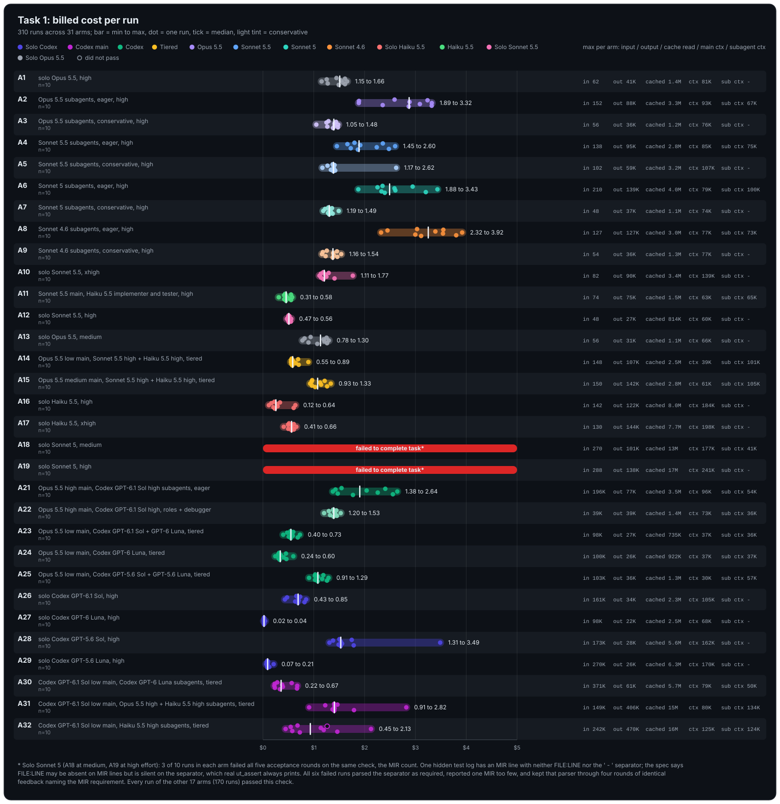
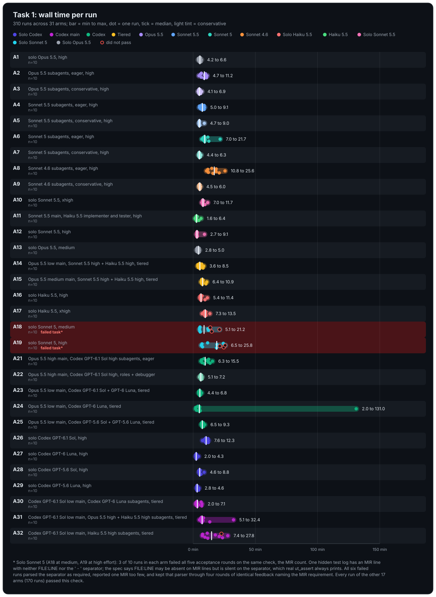

# Task 1 results (ut_assert log translator), 36 runs, 2026-10-18

All 36 runs passed acceptance. Billed cost includes compaction requests (none occurred). Ranges are min to max over the three repetitions; spend per pass is total spend over all attempts divided by passes.

## Spread across arms

The cost chart's right-hand columns give, per arm, the largest value seen in any one run: input, output and cache-read tokens summed over the main agent and all subagents, then the main agent's context peak and the largest subagent context peak (`-` when the arm spawned no subagents). Bars span min to max, dots are single runs, the tick is the median, and a lighter tint marks conservative arms.

## Full results

| Arm | Description | Task | Passes/attempts | Spend per pass USD | Cost per run USD | Cost spread USD | Wall min per run | Turns per run | Spawns | Rounds | Compactions | Main ctx peak (K tokens) | Subagent ctx peak (K tokens) |
|-----|-------------|------|----------------:|-------------------:|-----------------:|----------------:|-----------------:|--------------:|-------:|-------:|------------:|-------------------------:|-----------------------------:|
| A1 | solo Opus 5.5 | task1 | 3/3 | 1.42 | 1.15 to 1.66 | 0.50 | 4.2 to 6.0 | 25 to 32 | 0 | 1 | 0 | 61.7 to 81.3 | - |
| A2 | Opus 5.5 subagents, eager | task1 | 3/3 | 2.83 | 2.36 to 3.24 | 0.88 | 6.6 to 9.9 | 9 to 13 | 2 | 1 | 0 | 67.8 to 92.6 | 36.6 to 66.7 |
| A3 | Opus 5.5 subagents, conservative | task1 | 3/3 | 1.23 | 1.05 to 1.38 | 0.33 | 4.1 to 4.8 | 20 to 30 | 0 | 1 | 0 | 57.1 to 72.8 | - |
| A4 | Sonnet 5.5 subagents, eager | task1 | 3/3 | 2.00 | 1.66 to 2.60 | 0.94 | 5.2 to 8.9 | 3 to 12 | 2 to 4 | 1 | 0 | 64.3 to 85.3 | 29.9 to 69.3 |
| A5 | Sonnet 5.5 subagents, conservative | task1 | 3/3 | 1.77 | 1.27 to 2.62 | 1.35 | 4.7 to 9.0 | 20 to 55 | 0 | 1 to 4 | 0 | 68.8 to 106.5 | - |
| A6 | Sonnet 5 subagents, eager | task1 | 3/3 | 2.73 | 2.35 to 3.43 | 1.08 | 8.1 to 12.6 | 4 to 7 | 2 to 4 | 1 | 0 | 64.7 to 66.4 | 74.6 to 99.9 |
| A7 | Sonnet 5 subagents, conservative | task1 | 3/3 | 1.30 | 1.19 to 1.37 | 0.19 | 4.4 to 5.3 | 22 to 24 | 0 | 1 | 0 | 61.5 to 71.2 | - |
| A8 | Sonnet 4.6 subagents, eager | task1 | 3/3 | 3.70 | 3.39 to 3.92 | 0.53 | 15.9 to 25.6 | 3 to 17 | 3 to 4 | 1 | 0 | 69.6 to 77.0 | 52.7 to 72.9 |
| A9 | Sonnet 4.6 subagents, conservative | task1 | 3/3 | 1.38 | 1.23 to 1.46 | 0.23 | 5.1 to 5.4 | 25 to 29 | 0 | 1 | 0 | 64.0 to 76.8 | - |
| A10 | solo Sonnet 5.5, xhigh effort | task1 | 3/3 | 1.32 | 1.25 to 1.41 | 0.16 | 8.0 to 9.5 | 30 to 31 | 0 | 1 | 0 | 105.1 to 118.3 | - |
| A11 | Sonnet 5.5 main, Haiku 5.5 implementer and tester | task1 | 3/3 | 0.45 | 0.31 to 0.55 | 0.24 | 1.6 to 2.9 | 15 to 19 | 0 | 1 | 0 | 37.7 to 63.4 | - |
| A12 | solo Sonnet 5.5, high effort | task1 | 3/3 | 0.52 | 0.50 to 0.55 | 0.05 | 3.0 to 9.1 | 1 to 21 | 0 | 1 | 0 | 52.2 to 56.4 | - |

Notes: every conservative arm spawned zero subagents on this task, so A3, A5, A7, A9 are
behaviourally solo runs. One A5 run needed four rounds on the Markdown failures section
check. Eager arms spawned 2 to 4 subagents (implementer, tester, reviewer; occasionally a
built-in general-purpose agent, which the validator confirmed ran on the arm's model).

A10 to A12 (added later, same task, harness run code reviewed as equivalent): solo Sonnet 5.5 at high effort (A12) cost about 0.37 of solo Opus 5.5 (A1) per pass, and at xhigh effort (A10) about 0.93, with wall time roughly doubling. A11 (Sonnet 5.5 main, Haiku 5.5 implementer and tester) spawned nothing on this task, so it is behaviourally a solo Sonnet 5.5 high run; its 0.31 to 0.55 cost overlaps A12. The A12 turns range "1 to 21" is a counting artefact: in one run the CLI's final result came from a short turn triggered by a background-build notification, so `num_turns` reported 1 although the transcript shows 22 tool calls; that run's 9.1 minutes includes waiting on the background build.
