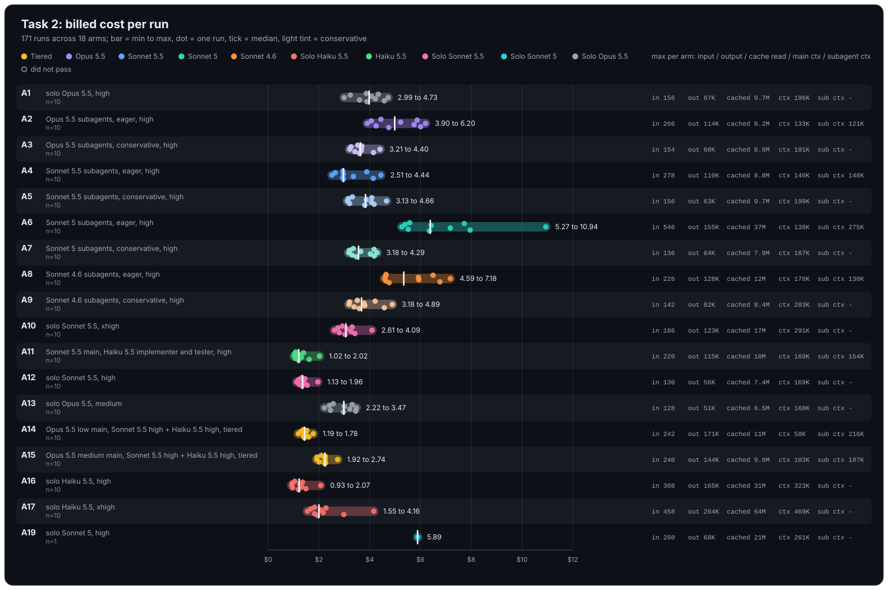
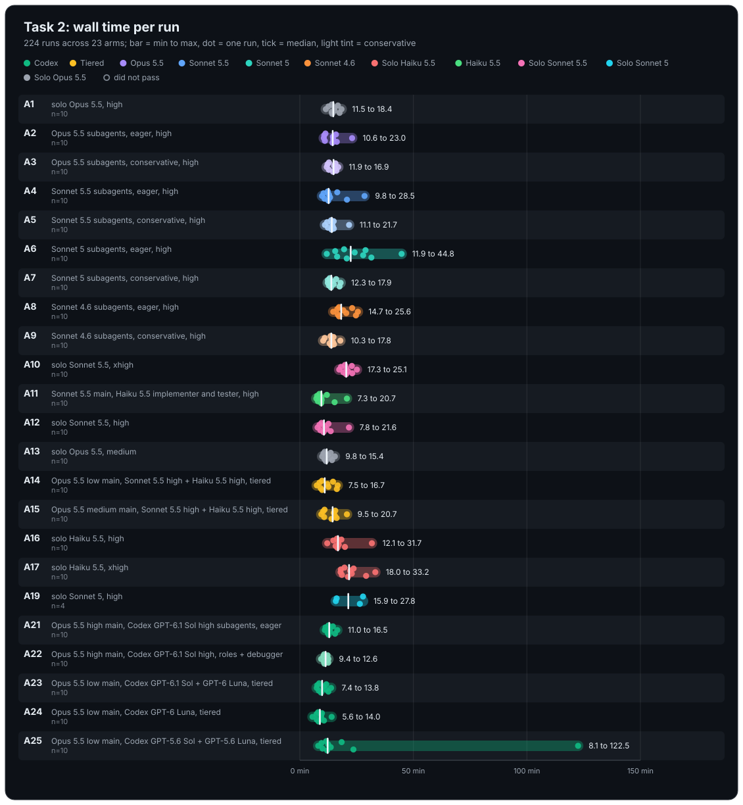

# Task 2 results (SAMPLE_APP status command), 90 runs, 2026-10-18

All 90 runs passed acceptance (10 repetitions per arm; the first three were run on
three parallel slots, the remaining seven on six). Billed cost includes compaction
requests (none occurred). Ranges are min to max over the ten repetitions; spend per
pass is total spend over all attempts divided by passes.

## Spread across arms

The cost chart's right-hand columns give, per arm, the largest value seen in any one run: input, output and cache-read tokens summed over the main agent and all subagents, then the main agent's context peak and the largest subagent context peak (`-` when the arm spawned no subagents). Bars span min to max, dots are single runs, the tick is the median, and a lighter tint marks conservative arms.

## Full results

| Arm | Description | Task | Passes/attempts | Spend per pass USD | Cost per run USD | Cost spread USD | Wall min per run | Turns per run | Spawns | Rounds | Compactions | Main ctx peak (K tokens) | Subagent ctx peak (K tokens) |
|-----|-------------|------|----------------:|-------------------:|-----------------:|----------------:|-----------------:|--------------:|-------:|-------:|------------:|-------------------------:|-----------------------------:|
| A1 | solo Opus 5.5 | task2 | 10/10 | 3.95 | 2.99 to 4.73 | 1.73 | 11.5 to 18.4 | 53 to 80 | 0 | 1 | 0 | 146.8 to 196.0 | - |
| A2 | Opus 5.5 subagents, eager | task2 | 10/10 | 5.05 | 3.90 to 6.20 | 2.30 | 10.7 to 25.9 | 3 to 19 | 2 to 4 | 1 to 2 | 0 | 71.6 to 133.3 | 75.1 to 120.6 |
| A3 | Opus 5.5 subagents, conservative | task2 | 10/10 | 3.66 | 3.21 to 4.40 | 1.19 | 11.9 to 16.9 | 7 to 75 | 0 | 1 | 0 | 154.6 to 190.8 | - |
| A4 | Sonnet 5.5 subagents, eager | task2 | 10/10 | 3.28 | 2.51 to 4.44 | 1.93 | 9.8 to 28.5 | 6 to 22 | 2 to 4 | 1 | 0 | 91.0 to 140.3 | 67.1 to 148.2 |
| A5 | Sonnet 5.5 subagents, conservative | task2 | 10/10 | 3.75 | 3.13 to 4.66 | 1.54 | 11.1 to 21.7 | 3 to 80 | 0 | 1 | 0 | 149.8 to 199.2 | - |
| A6 | Sonnet 5 subagents, eager | task2 | 10/10 | 6.83 | 5.27 to 10.94 | 5.67 | 15.6 to 44.8 | 6 to 29 | 2 to 4 | 1 to 2 | 0 | 81.0 to 138.4 | 135.7 to 274.6 |
| A7 | Sonnet 5 subagents, conservative | task2 | 10/10 | 3.68 | 3.18 to 4.29 | 1.11 | 12.3 to 17.9 | 52 to 74 | 0 | 1 | 0 | 154.2 to 186.9 | - |
| A8 | Sonnet 4.6 subagents, eager | task2 | 10/10 | 5.56 | 4.59 to 7.18 | 2.59 | 14.7 to 25.6 | 2 to 17 | 2 to 4 | 1 | 0 | 97.2 to 169.9 | 77.2 to 129.5 |
| A9 | Sonnet 4.6 subagents, conservative | task2 | 10/10 | 3.81 | 3.18 to 4.89 | 1.71 | 10.3 to 17.8 | 3 to 75 | 0 | 1 to 2 | 0 | 150.7 to 203.3 | - |

Spend per pass relative to solo Opus 5.5 (A1 = 1.00): A4 0.83, A3 0.93, A7 0.93,
A5 0.95, A9 0.96, A2 1.28, A8 1.41, A6 1.73.

Notes:

- Every conservative arm (A3, A5, A7, A9) spawned zero subagents in all 40 runs, so
  they are behaviourally solo Opus 5.5 runs; their cost ranges sit on top of A1's.
  The configured subagent model had no effect because no subagent ran.
- Eager Sonnet 5.5 delegation (A4) is the only delegation arm cheaper than solo on this
  task. Its ten-run range still overlaps A1's fully, so the difference is a shift of
  the distribution rather than a separation.
- Eager Opus 5.5 (A2) and eager Sonnet 4.6 (A8) cost 28 and 41 percent more per pass
  than solo. Eager Sonnet 5 (A6) is the worst cell: 73 percent more per pass, the
  widest spread (5.67 USD), the longest wall time (44.8 min), four of ten runs
  needing a second acceptance round, and a subagent context peak of 275K tokens.
- Delegation lowers the main agent's context peak (72 to 170K against 147 to 203K for
  solo and conservative arms) and gives the shortest wall times, but also the widest
  cost and wall-time spreads.
- No run compacted at the default window, although several solo and conservative runs
  peaked above 190K tokens of main-agent context.
- Second acceptance rounds: A2 one run, A6 four runs, A9 one run; all other runs passed
  on the first round.
- The aggregate warns that Task 1 runs carry a different run-code hash. The difference
  is the move of post-run analysis out of the run module between the two waves; the
  run pipeline itself was unchanged.
