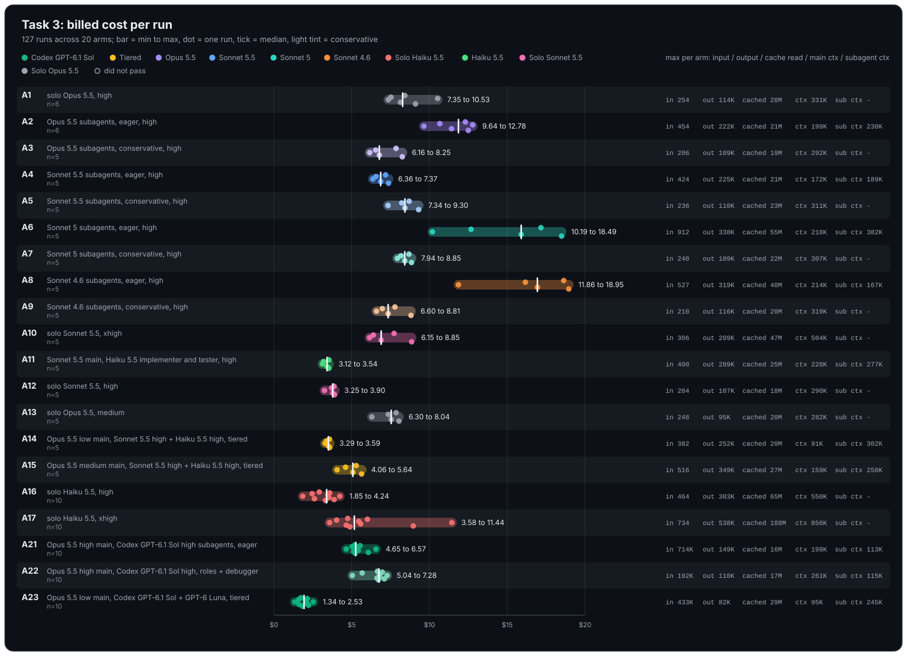
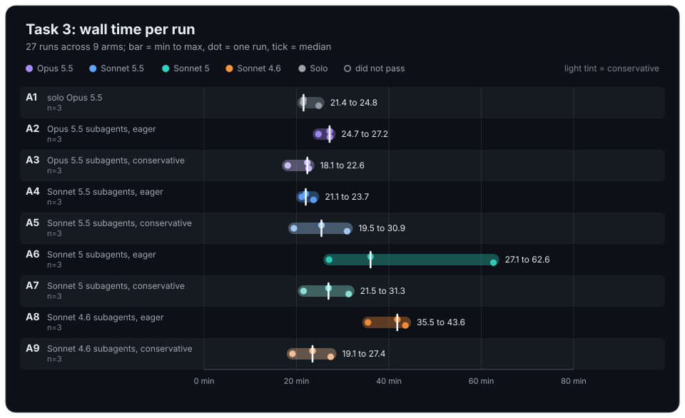

# Task 3 results (housekeeping staleness detection), 27 runs, 2026-10-18

All 27 valid runs passed acceptance. Billed cost includes compaction requests
(one occurred, in a subagent). Ranges are min to max over the three repetitions;
spend per pass is total spend over all attempts divided by passes. Nineteen
attempts from the first wave were cut off by the subscription session limit
(recorded as `cli_error`), dropped and rerun from scratch; they are excluded here.
The first eight runs were made on six parallel slots, the rest on three.

| Arm | Description | Task | Passes/attempts | Spend per pass USD | Cost per run USD | Cost spread USD | Wall min per run | Turns per run | Spawns | Rounds | Compactions | Main ctx peak (K tokens) | Subagent ctx peak (K tokens) |
|-----|-------------|------|----------------:|-------------------:|-----------------:|----------------:|-----------------:|--------------:|-------:|-------:|------------:|-------------------------:|-----------------------------:|
| A1 | solo Opus 5.5 | task3 | 3/3 | 8.83 | 7.53 to 10.53 | 3.00 | 21.4 to 24.8 | 96 to 141 | 0 | 1 | 0 | 275.1 to 330.5 | - |
| A2 | Opus 5.5 subagents, eager | task3 | 3/3 | 11.92 | 10.67 to 12.78 | 2.11 | 24.7 to 27.2 | 7 to 15 | 3 to 4 | 1 | 0 | 165.1 to 199.0 | 148.0 to 210.2 |
| A3 | Opus 5.5 subagents, conservative | task3 | 3/3 | 6.85 | 6.16 to 7.85 | 1.69 | 18.1 to 22.6 | 88 to 103 | 0 | 1 | 0 | 242.4 to 291.3 | - |
| A4 | Sonnet 5.5 subagents, eager | task3 | 3/3 | 6.87 | 6.56 to 7.18 | 0.62 | 21.1 to 23.7 | 7 | 3 to 4 | 1 | 0 | 143.1 to 172.0 | 162.3 to 188.7 |
| A5 | Sonnet 5.5 subagents, conservative | task3 | 3/3 | 8.45 | 7.34 to 9.30 | 1.96 | 19.5 to 30.9 | 101 to 123 | 0 | 1 | 0 | 268.4 to 310.8 | - |
| A6 | Sonnet 5 subagents, eager | task3 | 3/3 | 14.09 | 10.19 to 18.49 | 8.30 | 27.1 to 62.6 | 35 to 83 | 2 to 9 | 2 to 4 | 0 | 165.3 to 224.7 | 191.6 to 381.9 |
| A7 | Sonnet 5 subagents, conservative | task3 | 3/3 | 8.40 | 7.94 to 8.85 | 0.91 | 21.5 to 31.3 | 106 to 123 | 0 | 1 | 0 | 287.8 to 296.2 | - |
| A8 | Sonnet 4.6 subagents, eager | task3 | 3/3 | 15.31 | 10.05 to 18.95 | 8.90 | 35.5 to 43.6 | 22 to 104 | 2 to 4 | 1 to 3 | 0 to 1 | 196.6 to 251.2 | 163.0 to 165.3 |
| A9 | Sonnet 4.6 subagents, conservative | task3 | 3/3 | 7.58 | 6.60 to 8.81 | 2.21 | 19.1 to 27.4 | 96 to 114 | 0 | 1 | 0 | 250.3 to 318.7 | - |
Spend per pass relative to solo Opus 5.5 (A1 = 1.00): A3 0.78, A4 0.78, A9 0.86,
A7 0.95, A5 0.96, A2 1.35, A6 1.60, A8 1.73.

## Spread across arms

Notes:

- Eager Sonnet 5.5 delegation (A4) is the cheapest arm together with conservative
  Opus (A3), 22 percent under solo, with the tightest spread of the task (0.62 USD).
  Its three runs each took seven main-agent turns: the orchestrator did little
  besides delegate, and the main agent's context peaked at about half of solo's.
  This is the first task on which a delegation arm separates from solo rather than
  merely shifting the distribution.
- Every conservative arm again spawned zero subagents (21 of 21 runs on this task,
  58 of 58 across Tasks 1 to 3). Their costs sit within noise of solo; the A3 and
  A5 gap (6.85 against 8.45 per pass, identical main-agent behaviour) bounds that
  noise.
- Eager Opus 5.5 (A2) costs 35 percent more than solo and is slower in wall time:
  delegating to the same frontier model buys context headroom, not savings.
- Eager Sonnet 5 (A6) and eager Sonnet 4.6 (A8) are the expensive outliers at 60
  and 73 percent above solo, with cost spreads of 8.30 and 8.90 USD, wider than any
  other arm's whole range. A6 needed two to four acceptance rounds in every run;
  one run spawned nine subagents (including two debuggers) and took 63 minutes, and
  one subagent reached 382K tokens of context. A8 needed one to three rounds, and
  its runs took 36 to 44 minutes.
- First compaction in Experiment A: in A8 rep 3 a Sonnet 4.6 subagent auto-compacted
  at 172K tokens (195 seconds for the compaction request). Sonnet 4.6 runs in a 200K
  window; no main agent compacted, including solo runs peaking at 331K on Opus 5.5's
  1M window.
- Solo and conservative main agents peaked at 242K to 331K tokens; eager main agents
  at 143K to 251K; eager subagents at 148K to 382K.
- Second or later acceptance rounds: A6 three runs, A8 two runs; every other run
  passed on the first round.
