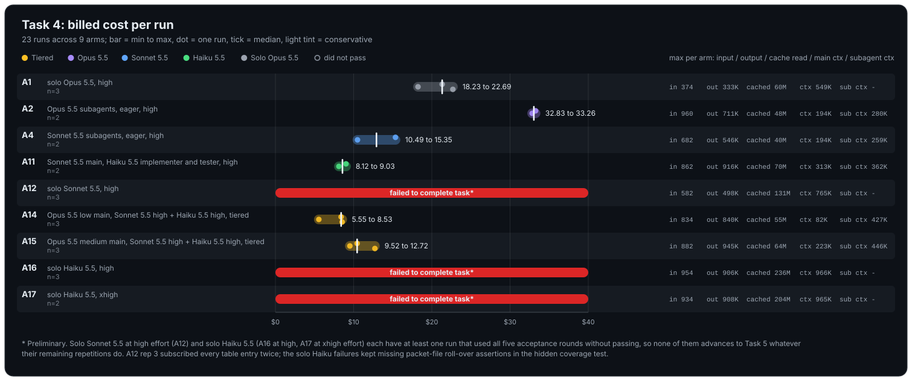
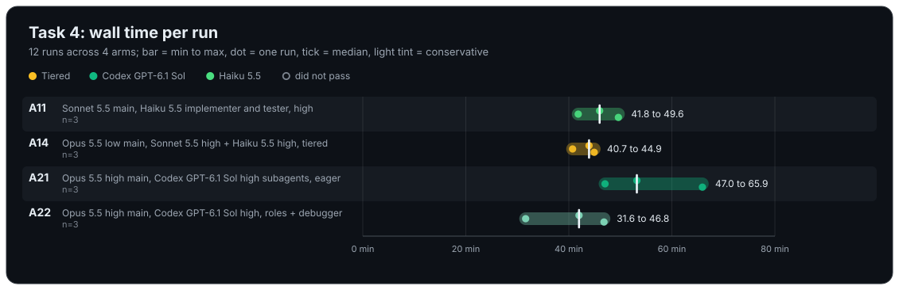

# Task 4 results (STOR storage app), 24 runs, 2026-10-21

Task 4 was redone from scratch on a corrected pack and spec. The original pack's cFS stubs
differed from real cFS in ways that decided pass/fail (an existing storage directory was an
error, table-update return codes and timing, duplicate-subscription counting, among
others), so all 25 runs on it are superseded and left out of these results. The corrected
pack models real cFS behaviour, the spec pins every choice a grader checks, and feedback
names each failing behaviour.

The corrected pack ran six arms, three repetitions each: A11 and A14, the cheapest
passing delegating arms on Tasks 1 to 3, the two Codex arms, A21 and A22, and A23, the
Codex counterpart of A14 added on 2026-10-20 (Opus 5.5 at low effort, tiered delegation to
Codex GPT-6.1 Sol and GPT-6 Luna), and A24, A23 with every subagent on GPT-6 Luna. Two Codex-main arms were added on 2026-10-21: A26
(solo headless Codex GPT-6.1 Sol at high effort) and A30 (GPT-6.1 Sol at low effort directing
built-in Codex subagents on GPT-6 Luna). Billed cost
includes the Codex subagents' API cost. Ranges are min to max over the repetitions; spend
per pass is total spend over all attempts divided by passes. Runs used four parallel slots.

## Spread across arms

The cost chart's right-hand columns give, per arm, the largest value seen in any one run: input, output and cache-read tokens summed over the main agent and all subagents, then the main agent's context peak and the largest subagent context peak (`-` when the arm spawned no subagents). Bars span min to max, dots are single runs (hollow when the run did not pass), the tick is the median, and a lighter tint marks conservative arms.

## Full results

| Arm | Description | Task | Passes/attempts | Spend per pass USD | Cost per run USD | Cost spread USD | Wall min per run | Turns per run | Spawns | Rounds | Compactions | Main ctx peak (K tokens) | Subagent ctx peak (K tokens) |
|-----|-------------|------|----------------:|-------------------:|-----------------:|----------------:|-----------------:|--------------:|-------:|-------:|------------:|-------------------------:|-----------------------------:|
| A11 | Sonnet 5.5 main, Haiku 5.5 implementer and tester | task4 | 3/3 | 10.36 | 8.20 to 12.12 | 3.91 | 41.8 to 49.6 | 18 to 133 | 5 to 6 | 1 | 0 | 352.5 to 405.4 | 279.8 to 371.6 |
| A14 | Opus 5.5 low main, Sonnet 5.5 + Haiku 5.5, tiered | task4 | 3/3 | 6.25 | 5.80 to 6.66 | 0.86 | 40.7 to 44.9 | 4 to 8 | 3 | 1 | 0 | 44.8 to 60.4 | 388.9 to 506.7 |
| A21 | Opus 5.5 high main, Codex GPT-6.1 Sol high subagents, eager | task4 | 3/3 | 7.78 | 7.03 to 8.40 | 1.38 | 47.0 to 65.9 | 11 to 14 | 6 | 1 | 0 | 111.0 to 168.2 | 131.1 to 186.0 |
| A22 | Opus 5.5 high main, Codex GPT-6.1 Sol high, roles + debugger | task4 | 3/3 | 11.22 | 10.34 to 12.89 | 2.56 | 31.6 to 46.8 | 16 to 108 | 1 to 2 | 1 | 0 | 294.1 to 349.7 | 111.6 to 126.9 |
| A23 | Opus 5.5 low main, Codex GPT-6.1 Sol + GPT-6 Luna, tiered | task4 | 3/3 | 2.26 | 1.80 to 2.60 | 0.79 | 30.9 to 77.0 | 4 to 17 | 2 to 5 | 1 to 2 | 0 | 36.4 to 71.4 | 134.4 to 212.3 |
| A24 | Opus 5.5 low main, Codex GPT-6 Luna, tiered | task4 | 3/3 | 2.76 | 2.59 to 3.00 | 0.41 | 61.6 to 75.1 | 26 to 49 | 6 to 8 | 2 to 3 | 0 | 97.4 to 110.1 | 160.6 to 173.8 |
| A26 | solo Codex GPT-6.1 Sol, high effort | task4 | 3/3 | 1.68 | 1.50 to 1.81 | 0.30 | 26.2 to 31.2 | 70 to 83 | 0 | 1 to 2 | 0 | 164.1 to 179.8 | - |
| A30 | Codex GPT-6.1 Sol low main, Codex GPT-6 Luna subagents, tiered | task4 | 3/3 | 3.41 | 2.46 to 4.41 | 1.94 | 27.7 to 45.5 | 152 to 225 | 6 to 8 | 2 | 1 to 2 | 132.3 to 219.3 | 172.6 to 179.9 |

Notes:

- All 24 runs passed. All but four of the first 18 passed in round one; five of the six A26
  and A30 runs needed a second round. On the original pack nearly every
  run needed a second round; the corrected pack removed the stub defects behind most of
  those misses.
- A23 (Opus 5.5 at low effort, implementer on Codex GPT-6.1 Sol, small implementer and
  tester on GPT-6 Luna) was the cheapest Opus-main arm, at 2.26 USD per pass (1.80 to 2.60),
  about a third of A14's. Codex was 67% of its spend; its Opus main agent cost 0.48 to
  1.01 USD per run. Rep 2 needed a second round (unit-test line coverage of one source file
  at 94.8% against 95%, and a missing limitations list in the report). Rep 3 took 77
  minutes, the slowest run of the task, against 31 and 51 for the other two.
- A24 (every subagent on GPT-6 Luna) passed all three runs but needed extra rounds in
  each, two, two and three, mostly for unit-test line coverage under 95 percent and the
  hidden coverage test, and once for file add, list and delete, quota rejection and
  counter reset. It cost 2.76 USD per pass, 22 percent more than A23, with Codex only 0.80
  per run: the extra rounds are spent on the Opus main agent. Its runs took 62 to 75
  minutes. The cheaper implementer that wins on Tasks 1 to 3 costs rounds on the hardest
  task.
- A14 (Opus 5.5 at low effort directing Sonnet 5.5 and Haiku 5.5) was the cheapest
  Claude-only arm, at 6.25 USD per pass with the tightest spread (5.80 to 6.66 USD). Its main agent
  stayed under 61K tokens of context in every run and delegated nearly all the work.
- A21 (Opus 5.5 main, Codex subagents, eager) was third at 7.78 USD per pass. Codex was
  60% of its spend (14.11 of 23.34 USD over three runs); the Opus main agent cost 2.25 to
  3.87 USD per run.
- A22 (Opus 5.5 main, Codex in fixed roles plus a debugger) spawned only one or two
  subagents and did most of the work in the main agent: 294K to 350K tokens of main
  context and up to 108 turns. Codex was 12% of its spend (3.95 of 33.65 USD), so it cost
  the most, 11.22 USD per pass, but it was also the fastest arm, 31.6 to 46.8 minutes.
- A11 (Sonnet 5.5 main, Haiku 5.5 implementer and tester) cost 10.36 USD per pass, with
  the widest spread (8.20 to 12.12 USD).
- A26 (solo GPT-6.1 Sol) is now the cheapest arm, at 1.68 USD per pass (1.50 to 1.81),
  0.74 of A23, and the fastest, 26 to 31 minutes per run. A30 costs 3.41 per pass (2.46 to
  4.41), about twice A26, with six to eight Luna spawns and one or two compactions per run.
- Every second round in A26 and A30 had one cause: the round-one report
  (docs/reports/stor.md) lacked a limitations section, and in three A30 runs a design
  summary as well. The spec lists limitations among the report's contents, and the
  feedback named the missing sections; each run fixed them in round two. The code passed
  every functional check in round one, so the extra rounds cost report work only.
- No solo Opus 5.5 (A1) baseline ran on the corrected pack, so Task 4 has no spend ratio
  against A1.
